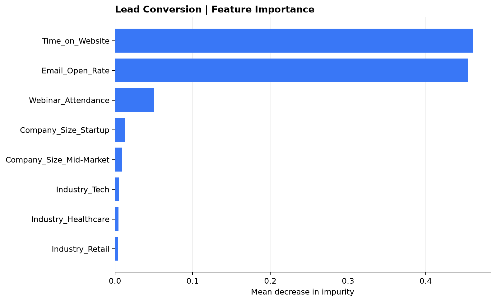
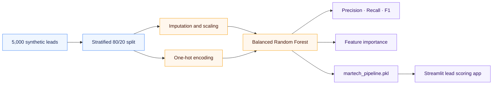

<div align="center">

# MartechMatch

### Predictive lead scoring for B2B marketing teams

Generate synthetic lead data, train an imbalance-aware Random Forest, and explore individual conversion scores in a Streamlit dashboard.

[](https://www.python.org/)
[](https://scikit-learn.org/)
[](https://streamlit.io/)
[](leads_data.csv)

[Evaluation](#evaluation) · [Model pipeline](#model-pipeline) · [Run the dashboard](#run-locally)

</div>

---

<table>
<tr>
<td align="center"><strong>5,000</strong><br><sub>SYNTHETIC LEADS</sub></td>
<td align="center"><strong>15%</strong><br><sub>CONVERSION RATE</sub></td>
<td align="center"><strong>80 / 20</strong><br><sub>STRATIFIED SPLIT</sub></td>
<td align="center"><strong>0.864</strong><br><sub>CONVERTED F1</sub></td>
</tr>
</table>

## Evaluation

Held-out metrics from a stratified test set of 1,000 leads. The dataset is imbalanced, so converted-lead precision, recall, and F1 are highlighted alongside overall accuracy.

| Outcome | Precision | Recall | F1-score | Test leads |
|:--|--:|--:|--:|--:|
| **Converted** | **0.842** | **0.887** | **0.864** | 150 |
| Not converted | 0.980 | 0.971 | 0.975 | 850 |
| Overall accuracy | — | — | **0.958** | **1,000** |

<table>
<tr>
<td width="100%" valign="top">
<strong>Feature importance</strong><br><br>

</td>
</tr>
</table>

## Model pipeline



| Stage | Implementation |
|:--|:--|
| **Numeric features** | Median imputation → standard scaling |
| **Categorical features** | Most-frequent imputation → one-hot encoding (`drop="first"`) |
| **Classifier** | 700-tree `RandomForestClassifier`, `class_weight="balanced_subsample"` |
| **Evaluation** | Held-out classification report with precision, recall, and F1 |
| **Artifacts** | Serialized pipeline and feature-importance chart |

## Lead inputs

| Feature | Type | Values |
|:--|:--|:--|
| `Time_on_Website` | Numeric | Seconds |
| `Email_Open_Rate` | Numeric | 0.0–1.0 |
| `Webinar_Attendance` | Binary | 0 or 1 |
| `Industry` | Categorical | Tech · Healthcare · Finance · Retail |
| `Company_Size` | Categorical | Startup · Mid-Market · Enterprise |
| `Converted` | Target | 0 or 1 |

The dashboard displays the model's conversion probability and uses its predicted class to recommend either **High-Value Lead: Route to Sales** or **Low-Value Lead: Keep in Nurture Campaign**. A 0.5 classification threshold is used by the classifier; adjust operating thresholds only after evaluating real sales capacity and business costs.

## Run locally

```bash
python -m venv .venv
# Windows PowerShell:
.\.venv\Scripts\Activate.ps1
# macOS/Linux: source .venv/bin/activate

pip install -r requirements.txt
python train_model.py
streamlit run app.py
```

Training writes `leads_data.csv`, `feature_importance.png`, and `martech_pipeline.pkl` in the project root. The model pickle is excluded from Git and is regenerated by `python train_model.py`.

## Project structure

```text
├── app.py
├── train_model.py
├── leads_data.csv
├── feature_importance.png
├── requirements.txt
└── README.md
```

> [!NOTE]
> This is a synthetic-data demonstration with a single holdout evaluation. The metrics are not evidence of production performance. Validate against historical data, review subgroup behavior, and assess the score threshold against real business costs before operational use.
