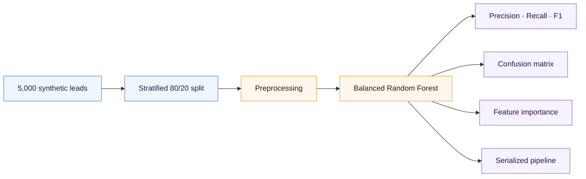

<div align="center">

# Predictive Lead Scoring

### Turn marketing signals into a clearer sales priority.

A reproducible, end-to-end machine learning project for identifying B2B leads with a higher likelihood to convert.

[](https://www.python.org/)
[](https://scikit-learn.org/)
[](leads_data.csv)
[](#evaluation)

[Explore the results](#evaluation) · [See the pipeline](#pipeline) · [Run the project](#run-locally)

</div>

---

<table>
<tr>
<td align="center"><strong>5,000</strong><br><sub>SYNTHETIC LEADS</sub></td>
<td align="center"><strong>14.7%</strong><br><sub>CONVERSION RATE</sub></td>
<td align="center"><strong>80 / 20</strong><br><sub>STRATIFIED SPLIT</sub></td>
<td align="center"><strong>0.31</strong><br><sub>CONVERTED F1</sub></td>
</tr>
</table>

## Evaluation

Metrics are measured on 1,000 held-out leads. With an imbalanced target, converted-lead precision, recall, and F1 give a more useful view than accuracy alone.

| Outcome | Precision | Recall | F1-score | Leads |
|:--|--:|--:|--:|--:|
| **Converted** | **0.30** | **0.31** | **0.31** | 147 |
| Not converted | 0.88 | 0.87 | 0.88 | 853 |
| Overall accuracy | — | — | **0.79** | **1,000** |

<details>
<summary>How to read this result</summary>
<br>

At the default 0.5 threshold, the model finds about 31% of converting leads. False positives use sales capacity on leads that do not convert; false negatives leave potential customers untouched. The right operating threshold depends on the sales team's capacity and the business cost of each outcome.

</details>

<table>
<tr>
<td width="50%" valign="top">
<strong>Confusion matrix</strong><br><br>

</td>
<td width="50%" valign="top">
<strong>Top five feature importances</strong><br><br>

</td>
</tr>
</table>

## Pipeline



| Stage | Implementation |
|:--|:--|
| **Numeric features** | Median imputation → standard scaling |
| **Categorical features** | Most-frequent imputation → one-hot encoding (`drop="first"`) |
| **Classifier** | 400-tree `RandomForestClassifier`, `class_weight="balanced"` |
| **Reproducibility** | Fixed random seed for data generation, split, and model |
| **Outputs** | Classification report, charts, and `joblib` pipeline |

## Data

| Feature | Type | Values |
|:--|:--|:--|
| `Time_on_Website` | Numeric | Seconds |
| `Email_Open_Rate` | Numeric | 0.0–1.0 |
| `Webinar_Attendance` | Binary | 0 or 1 |
| `Company_Size` | Categorical | Startup · Mid-Market · Enterprise |
| `Industry` | Categorical | Tech · Healthcare · Finance · Retail |
| `Lead_Source` | Categorical | Organic · Paid Ads · Referral |
| `Converted` | Target | 0 or 1 |

### Leading signals

| Feature | Importance |
|:--|--:|
| Email open rate | 41.45% |
| Time on website | 40.44% |
| Webinar attendance | 3.63% |
| Tech industry | 2.36% |
| Paid Ads lead source | 2.29% |

<sub>Importances are impurity-based measures of model reliance; they do not establish cause and effect.</sub>

## Run locally

```bash
python -m venv .venv
# Activate the environment, then:
pip install -r requirements.txt
python src/generate_data.py
python src/train_model.py
```

The scripts generate `leads_data.csv`, both charts under `artifacts/`, and `lead_scoring_pipeline.pkl` in the project root. The model file is excluded from Git and can be regenerated with the training command.

<details>
<summary>Project structure</summary>

```text
├── artifacts/
│   ├── confusion_matrix.png
│   └── feature_importance_top5.png
├── src/
│   ├── generate_data.py
│   └── train_model.py
├── leads_data.csv
├── requirements.txt
└── README.md
```

</details>

> [!NOTE]
> This project uses synthetic data and a single holdout split. It demonstrates a modeling workflow, not production performance. Validate on historical data, review subgroup behavior, and select a threshold against real business costs before operational use.
