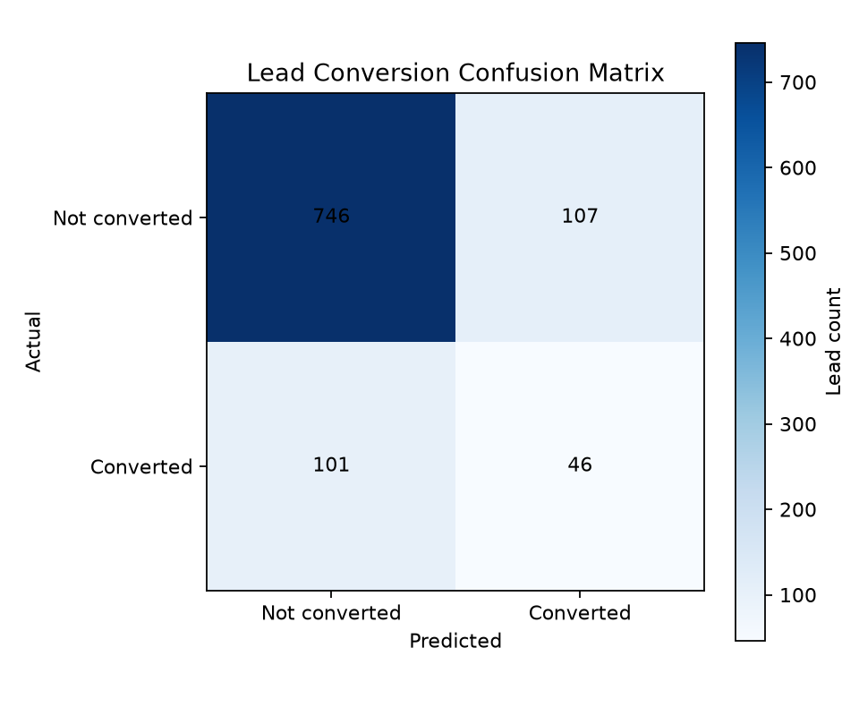
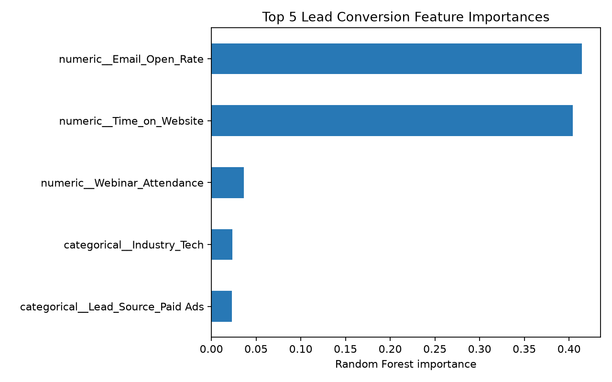

# Predictive Lead Scoring

**A reproducible machine learning pipeline for prioritizing B2B marketing leads.** Built with Python and scikit-learn, this project generates an imbalanced synthetic dataset, trains a class-balanced Random Forest, and evaluates conversion predictions with metrics that matter to sales teams.

[Dataset](leads_data.csv) · [Training script](src/train_model.py) · [Confusion matrix](artifacts/confusion_matrix.png) · [Feature importance](artifacts/feature_importance_top5.png)

| Leads | Conversion rate | Test split | Converted F1 |
|:--|--:|--:|--:|
| 5,000 | 14.7% | 1,000 leads | 0.31 |

## Results

Evaluation uses a stratified 80/20 train/test split. The minority class is conversion, so its precision, recall, and F1 are highlighted below. Accuracy alone would hide how the model performs on the leads sales teams want to find.

| Class | Precision | Recall | F1-score | Test leads |
|:--|--:|--:|--:|--:|
| Converted | 0.30 | 0.31 | 0.31 | 147 |
| Not converted | 0.88 | 0.87 | 0.88 | 853 |
| **Overall accuracy** |  |  | **0.79** | **1,000** |

The model uses a 0.5 classification threshold. False positives can consume sales capacity on leads that do not convert; false negatives can leave potential customers untouched. Threshold selection should reflect the cost and capacity of the sales process.

### Confusion matrix



## Approach

1. **Generate data** — Create 5,000 synthetic leads with a reproducible random seed and an approximately 15% conversion rate.
2. **Preprocess** — Median-impute and scale numeric features; most-frequent-impute and one-hot encode categories, dropping the first category.
3. **Train** — Fit a 400-tree Random Forest with `class_weight="balanced"` on a stratified 80/20 split.
4. **Evaluate** — Print class-level precision, recall, and F1; save a confusion matrix and top-five feature importance chart.
5. **Serialize** — Save the complete fitted preprocessing and classifier pipeline with `joblib`.

## Data

| Feature | Type | Values |
|:--|:--|:--|
| `Time_on_Website` | Numeric | Seconds |
| `Email_Open_Rate` | Numeric | 0.0–1.0 |
| `Webinar_Attendance` | Binary | 0 or 1 |
| `Company_Size` | Categorical | Startup, Mid-Market, Enterprise |
| `Industry` | Categorical | Tech, Healthcare, Finance, Retail |
| `Lead_Source` | Categorical | Organic, Paid Ads, Referral |
| `Converted` | Target | 0 or 1 |

### Most influential features



| Feature | Importance |
|:--|--:|
| Email open rate | 41.45% |
| Time on website | 40.44% |
| Webinar attendance | 3.63% |
| Tech industry | 2.36% |
| Paid Ads lead source | 2.29% |

Importances are impurity-based and indicate model reliance, not causal effects.

## Run locally

```bash
python -m venv .venv
# Activate the environment, then:
pip install -r requirements.txt
python src/generate_data.py
python src/train_model.py
```

The scripts write `leads_data.csv`, the charts in `artifacts/`, and `lead_scoring_pipeline.pkl` in the project root. The serialized model is excluded from Git; regenerate it with the training command above.

## Project structure

```text
├── artifacts/
│   ├── confusion_matrix.png
│   └── feature_importance_top5.png
├── src/
│   ├── generate_data.py
│   └── train_model.py
├── leads_data.csv
├── requirements.txt
└── README.md
```

## Limitations

The data is synthetic and the evaluation is a single holdout split. These results demonstrate an end-to-end workflow; they are not evidence of production performance. Before operational use, validate on real historical data, review subgroup behavior, and tune the decision threshold against business costs.
